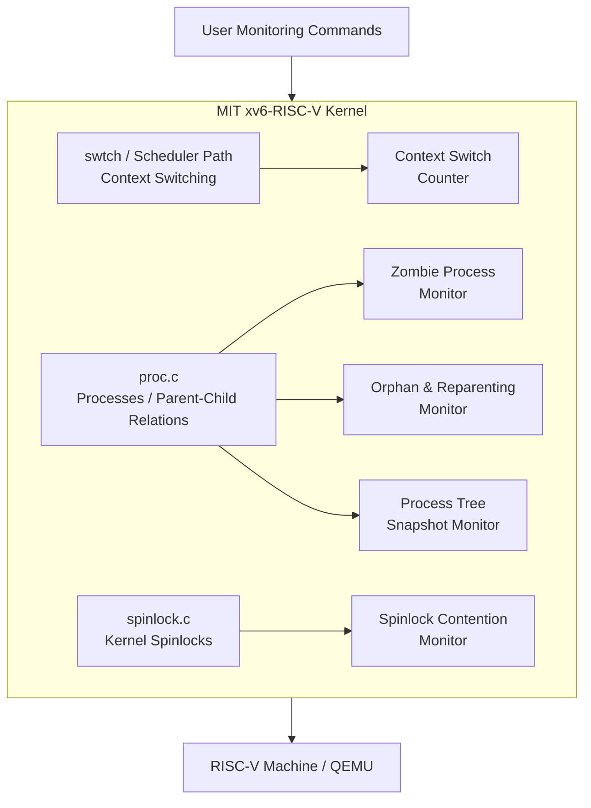
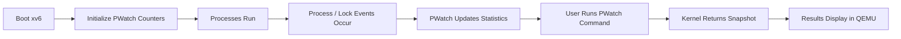

# OS-Project
# PWatch — Process & Synchronization Observability for xv6-RISC-V

> **Operating Systems Project Proposal**  
> **Student:** Shabaz  
> Base Kernel: **MIT xv6-RISC-V**

---

## Project Overview

**PWatch** is an Operating Systems project based on the official **MIT xv6-RISC-V kernel**.

The project will extend xv6 with **5 proposed lightweight kernel modules** focused on process switching, zombie processes, orphan/reparenting activity, parent-child process relationships, and spinlock contention.

The goal is to observe important process and synchronization behavior without replacing the original xv6 scheduler or locking design.

---

## Proposed 5 Modules

### 1. Context Switch Counter
Counts how many process context switches occur while xv6 is running.

### 2. Zombie Process Monitor
Tracks how many processes enter the ZOMBIE state and how many are later collected by their parent.

### 3. Orphan & Reparenting Monitor
Tracks processes whose parent exits and records how often xv6 reparents them to the init process.

### 4. Process Tree Snapshot Monitor
Displays a simple parent-child process tree using process IDs and parent relationships.

### 5. Spinlock Contention Monitor
Tracks spinlock acquisition attempts and counts cases where a CPU has to wait because a lock is already busy.

---

## System Architecture



---

## Working Flow



---

## Final Goal

```text
MIT xv6-RISC-V
      +
5 Process & Synchronization Modules
      =
PWatch Enhanced xv6 Kernel
```

The project is designed to remain simple enough to implement and explain while still demonstrating important Operating Systems concepts such as context switching, process relationships, zombie handling, reparenting, and synchronization.

---

## Current Status

**Status:** Project Selection / Planning Stage  
**Implementation:** Not started yet  
**Next Step:** Run the original xv6 kernel successfully and then implement each PWatch module one by one.
